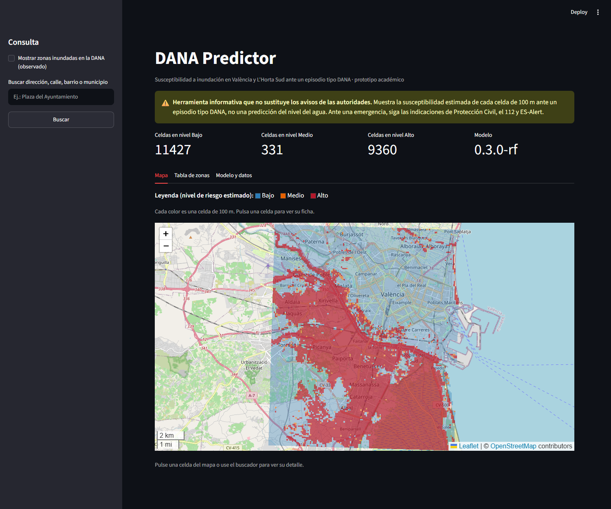
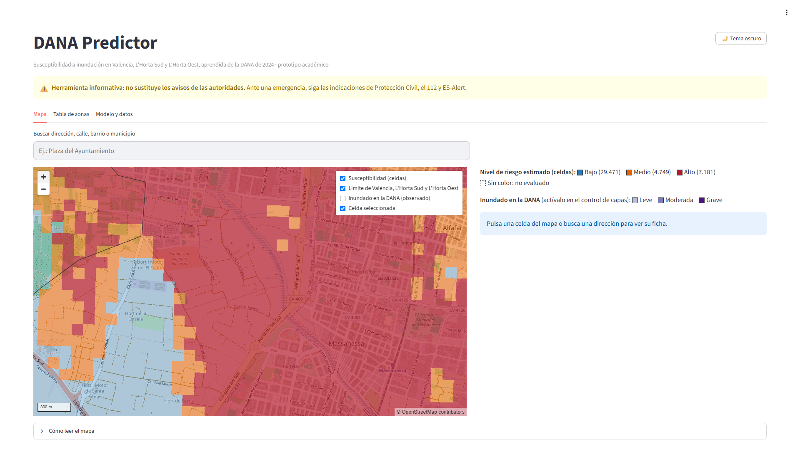
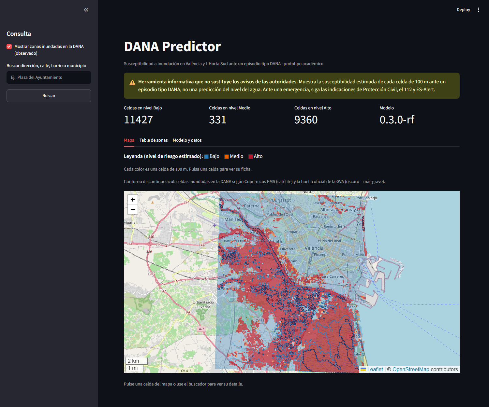
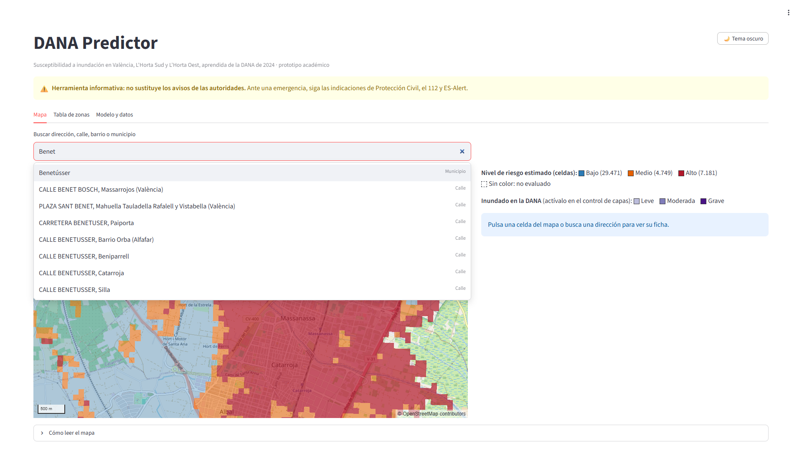
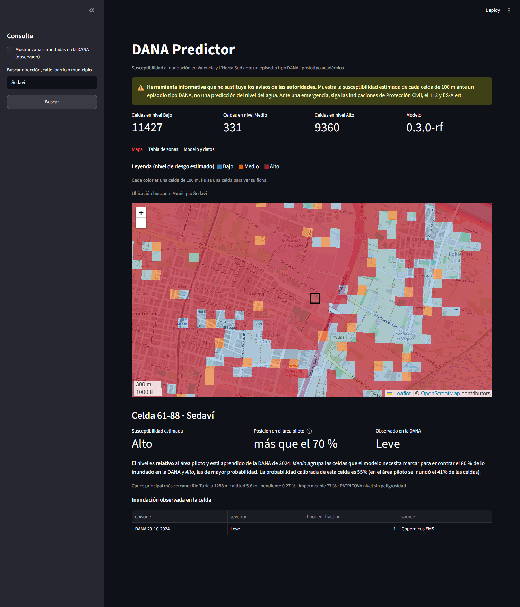
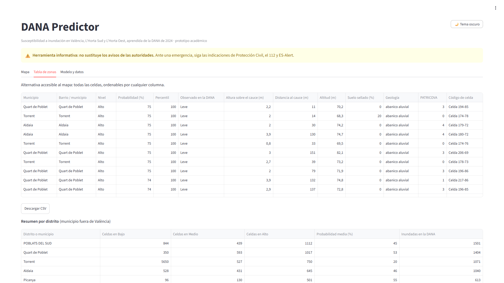
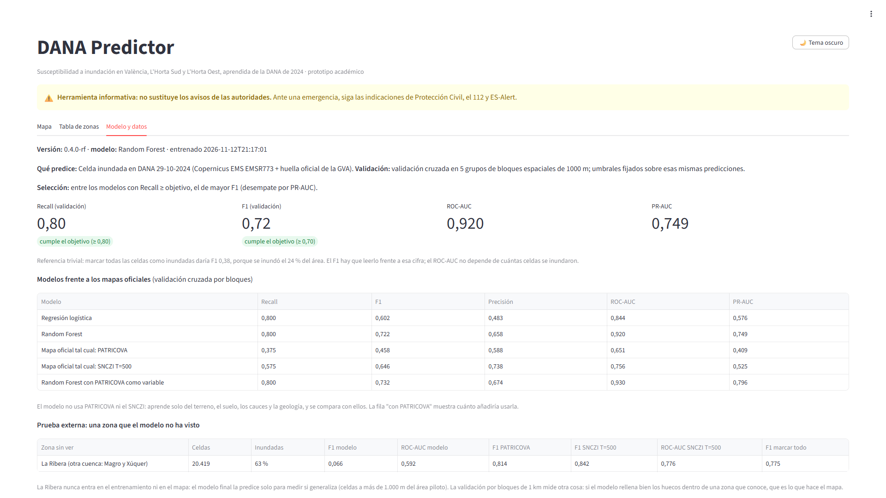
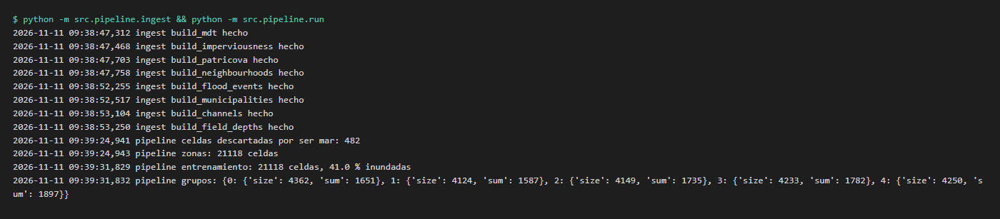
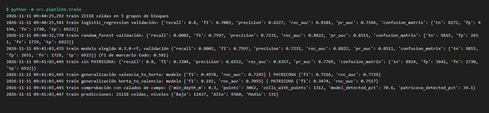
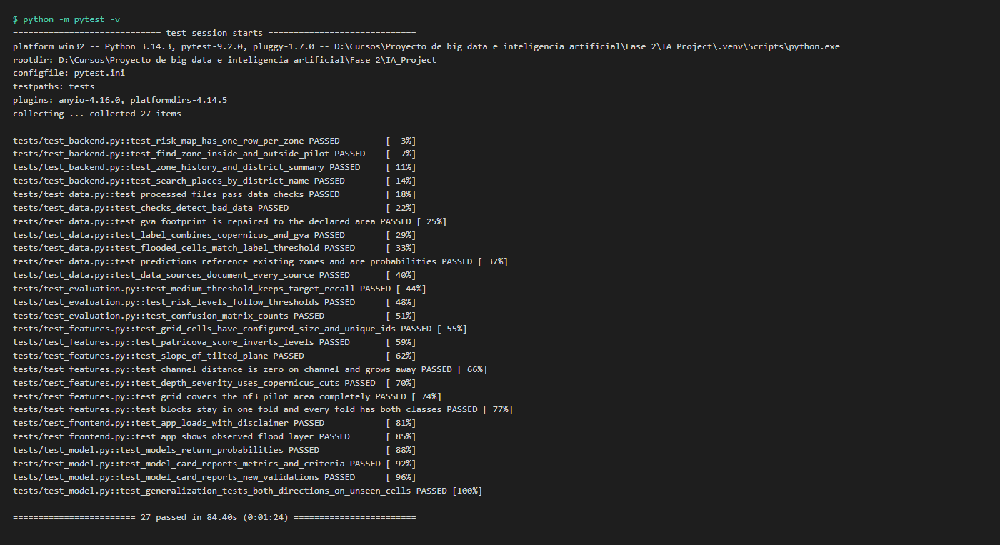

# NF3. Producto funcional local y repositorio

## 1. Portada

- **Proyecto:** DANA Predictor, mapa de susceptibilidad a inundación aprendido de la DANA de 2024 en València,
  L'Horta Sud y L'Horta Oest
- **Integrantes (Grupo 10):** Dennis Bonilla, Rafael Chambilla, Víctor Martínez, Jaume Palau
- **Fecha:** 12/11/2026
- **Autor del documento:** Grupo 10
- **Repositorio:** https://github.com/Victorproyecto/IA_Project
- **Versión entregada:** tag `nf3-entrega` de la rama `main`

## 2. Estado actual del producto

**Completo**

- Ingesta reproducible de 11 fuentes reales desde sus descargas originales (`src/pipeline/ingest.py`), incluida la
  reparación de la huella oficial de la GVA, que llega con geometría inválida, y el cálculo de la altura sobre el cauce
  (HAND) siguiendo el flujo del agua sobre el MDT. Los datos no se versionan: los originales (`data/raw`, 1,7 GB)
  están en Google Drive y el resto se genera con `ingest`, `run` y `train`.
- Preparación: 41.401 celdas de 100 m en los 22 municipios del área (València, L'Horta Sud y L'Horta Oest), 9
  variables (altitud, pendiente, suelo sellado, distancia al cauce principal, altura sobre el cauce y 4 de geología)
  y etiqueta de la DANA (Copernicus EMS + huella de la GVA: 9.765 celdas inundadas, el 24 %). Se excluyen el mar, los
  arrozales y el agua permanente.
- Entrenamiento de 2 modelos con validación cruzada por bloques espaciales de 1 km, comparación con PATRICOVA y el
  SNCZI, prueba externa en la Ribera (otra cuenca), comprobación con calados de campo, ficha del modelo y
  predicciones.
- Aplicación: mapa de celdas de 100 m con JavaScript (MapLibre), capa de lo inundado en la DANA, buscador con
  sugerencias de municipios, barrios, calles y direcciones, ficha de celda explicada, tabla accesible y ficha del
  modelo.
- 33 tests automáticos (también en Windows), Docker y CI.

**Parcial**

- El modelo (Random Forest `0.4.0-rf`) cumple los dos criterios de la Fase 1: Recall 0,80 y **F1 0,722 frente al
  objetivo de 0,70, con poco margen**. El F1 hay que leerlo frente a 0,38, que es lo que daría marcar todas las celdas
  como inundadas; el ROC-AUC es 0,92. El objetivo se alcanza al añadir la altura sobre el cauce (sin ella, 0,687) y
  con el método de validación del proyecto (bloques de 1 km): con bloques de 3 km el F1 es 0,63 con y sin esa
  variable (detalle en `docs/MEJORAS_MODELO_NF3.md`, apartado 2.5).
- Dentro del área supera a los mapas oficiales: F1 0,72 frente a 0,65 del SNCZI (T=500) y 0,46 de PATRICOVA. La
  comparación favorece algo al modelo, que aprende de esta misma DANA, mientras que los mapas oficiales son
  anteriores. Aun así, el 62 % de las celdas inundadas (6.102 de 9.765) estaba fuera de PATRICOVA.
- **En otra cuenca no generaliza:** en la Ribera (que el modelo nunca ve) su ROC-AUC es 0,59, mientras que PATRICOVA
  y el SNCZI alcanzan 0,80 y 0,78. Con un solo episodio, el modelo aprende cómo se inundó cada zona en 2024, no
  reglas que se trasladen a otra.
- En la CI se saltan los tests que necesitan datos, porque `data/` no se versiona. En local, con los datos, pasan los
  33.

**Cambio de alcance respecto a la Fase 1**

La Fase 1 limitaba el piloto a la ciudad de València. Se amplía a L'Horta Sud y L'Horta Oest porque es donde la DANA
causó más daño y donde el producto tiene más sentido, y porque permite medir si el modelo generaliza a una cuenca que
no ha visto (la Ribera). Detalle en `docs/MEJORAS_MODELO_NF3.md`.

**Pendiente para NF4**

- Entrenar con varios episodios (otras activaciones de Copernicus EMS) y validar dejando fuera un episodio entero.
- Las funciones de la Fase 1 que dependen de la lluvia: la lluvia como variable del modelo, el control de franjas
  horarias con la previsión de AEMET y el selector de episodio o escenario. Con un solo episodio la lluvia no se puede
  aprender, así que necesitan el punto anterior.

## 3. Guía de ejecución local

**Requisitos:** Python 3.12 (o Docker), unos 3 GB libres y los datos originales (1,7 GB). Están en un zip en Google
Drive (https://drive.google.com/file/d/176-uFyjY6HrutmeO81buOrQoFvy12swU/view) que se descomprime dentro de `data/`,
de modo que quede `data/raw/` (detalle en `docs/DATOS.md`). El navegador necesita conexión a internet para el mapa
de fondo, la librería del mapa y las sugerencias de direcciones.
**Variables de entorno:** ninguna obligatoria. `DATA_DIR` permite usar otra carpeta de datos.

```bash
git clone https://github.com/Victorproyecto/IA_Project.git
cd IA_Project
git checkout nf3-entrega
python3 -m venv .venv && source .venv/bin/activate
pip install -r environment/requirements.txt
# antes: descomprimir el zip de Google Drive dentro de data/ (queda data/raw/)
python -m src.pipeline.ingest
python -m src.pipeline.run
python -m src.pipeline.train
streamlit run src/frontend/app.py      # http://localhost:8501
python -m pytest
```

**Orden de arranque:** ingest → run → train → app. Cada paso lee lo que escribe el anterior. Con Docker, los mismos
pasos están en el README.

## 4. Evidencias funcionales

Capturas de la aplicación en local (http://localhost:8501) y de la terminal, con el código de esta versión. En las de
terminal se omiten los avisos de las librerías.

**Front funcionando: mapa de susceptibilidad.** Cada color es una celda de 100 m, en València, L'Horta Sud y L'Horta
Oest.



**Front: detalle de la zona cero.** Paiporta, Sedaví y Benetússer al acercar el mapa.



**Front: capa de lo inundado en la DANA** (Copernicus EMS y huella oficial de la GVA)



**Front: buscador con sugerencias.** Al escribir, sugiere al instante municipios, distritos y barrios y, a partir de
3 letras, calles y direcciones del área (CartoCiudad, del IGN).



**Backend activo: búsqueda de un municipio y detalle de la celda.** El frontend pide a `services.py` la celda, su
nivel, la posición relativa, el cauce más cercano, las variables y lo observado con su fuente. Las funciones del
backend también las comprueba `tests/test_backend.py` (captura de pytest en el apartado 7).



**Front: tabla accesible y resumen por distrito o municipio**



**Flujo completo: ficha del modelo en la aplicación.** Comparativa con PATRICOVA y el SNCZI, prueba externa en la
Ribera, referencia trivial y comprobación con calados de campo.



**Flujo completo en terminal: ingesta y preparación**



**Flujo completo en terminal: entrenamiento**



## 5. Arquitectura implementada

```
data/raw ─ingest─► data/preparados ─run─► data/procesados ─train─► data/modelos
                                                                           │
                               frontend (Streamlit) ◄── backend (services.py) ◄┘
```

- **Pipeline por lotes:** se ejecuta una vez y deja los resultados en Parquet / GeoParquet. No hay base de datos.
- **Backend:** módulo Python que lee esos resultados. El frontend solo accede a los datos a través de él.
- **Frontend:** Streamlit, en el mismo proceso que el backend, con dos componentes JavaScript propios: el mapa de
  celdas (MapLibre GL JS) y el buscador con sugerencias de direcciones (CartoCiudad, del IGN).

**Respecto al diseño de la Fase 1.** Se mantienen las capas del diseño: datos en Parquet / GeoParquet sin servidor de
base de datos, pipeline, modelo, una capa de acceso a datos que separa la aplicación del almacenamiento y la
aplicación en Streamlit, todo en Python y en una imagen Docker con `data/` como volumen. Las diferencias son estas:

- La capa de acceso a datos (`data_access` en la Fase 1) es `src/backend/services.py`. Como estaba previsto para el
  MVP, no es una API ni un servicio aparte.
- La ingesta parte de los ficheros descargados en `data/raw` en lugar de descargarlos desde los scripts, porque varias
  fuentes piden cuenta (Copernicus Land) o se descargan desde visores y servicios WFS.
- La imagen Docker tiene cuatro puntos de entrada (`ingest`, `pipeline`, `train` y `app`) más uno para los tests, en
  lugar de tres.
- El mapa y el buscador son componentes JavaScript propios dentro de Streamlit.
- El área (22 municipios en lugar de la ciudad de València), la celda de 100 m en lugar de 250 m y el modelo sin
  lluvia se explican en el apartado 2.

## 6. Índice de código

```
README.md
pytest.ini
.env.example
.gitignore
.dockerignore
.github/workflows/ci.yml
src/
├── config.py
├── pipeline/
│   ├── ingest.py
│   ├── grid.py
│   ├── sources.py
│   ├── features.py
│   ├── blocks.py
│   ├── checks.py
│   ├── run.py
│   ├── evaluation.py
│   ├── train.py
│   └── predict.py
├── backend/
│   └── services.py
└── frontend/
    ├── app.py
    └── components/
        ├── cell_map.js / cell_map.css
        ├── place_search.js / place_search.css
        └── __init__.py
tests/
├── conftest.py
├── test_features.py
├── test_evaluation.py
├── test_data.py
├── test_model.py
├── test_backend.py
└── test_frontend.py
environment/
├── requirements.txt
├── Dockerfile
├── docker-compose.yml
└── entrypoint.sh
data/                        (no se versiona: raw está en Google Drive y el resto se genera)
docs/
├── DATOS.md
├── ENTREGA_NF3.md
├── MEJORAS_MODELO_NF3.md
├── modelo_datos.png
├── capturas/
└── entregas/
```

## 7. Repositorio versionado y reproducible

- **Enlace y versión:** https://github.com/Victorproyecto/IA_Project, tag `nf3-entrega` (rama `main`).
- **README:** requisitos, configuración y comandos.
- **Dependencias:** `environment/requirements.txt` con versiones fijadas. `.env.example` sin secretos.
- **Pruebas:** `python -m pytest` (33 tests, también en Windows, unos 35 s) y CI en `.github/workflows/ci.yml`.
  Resultado:


- **Datos:** no se versiona nada de `data/`. Los originales (1,7 GB) están en Google Drive y el resto lo generan
  `ingest`, `run` y `train`. `docs/DATOS.md` indica la fuente, la licencia y cómo descargar cada fichero.

## 8. Explicación por módulo

**Pipeline** (`src/pipeline/`)

- `ingest.py`: une y recorta las descargas originales y genera `data/preparados/` (terreno, suelo sellado, PATRICOVA,
  barrios, etiqueta de la DANA con Copernicus EMS y la huella de la GVA reparada, municipios, cauces principales,
  calados de campo, suelo no urbano de Corine, geología del IGME y zona inundable del SNCZI). Con el MDT y los cauces
  calcula la altura sobre el cauce (HAND): sigue el agua de cada píxel cuesta abajo hasta su cauce, el mar o la
  Albufera, con `pysheds` para la dirección del flujo.
- `grid.py`: crea la cuadrícula de 100 m sobre el área piloto, fijada en metros, y calcula la pendiente.
- `sources.py`: lleva cada fuente a la celda (media de 25 puntos en rásteres, cruce espacial en vectores), asigna
  municipio y barrio por mayor superficie, calcula la distancia al cauce principal, la altura media sobre el cauce y la
  gravedad de lo inundado (completada con los calados de campo).
- `features.py`: invierte PATRICOVA para que más sea peor (solo para la comparación) y define la unidad territorial
  (barrio o distrito en València, municipio fuera).
- `blocks.py`: agrupa las celdas en bloques de 1 km y los reparte en 5 grupos de validación.
- `checks.py`: comprueba los datos antes de escribir.
- `run.py`: orquesta la preparación (área piloto y prueba externa) y escribe las tablas.
- `evaluation.py`: métricas, umbrales Bajo / Medio / Alto y comprobación con calados.
- `train.py`: validación cruzada de 2 modelos, selección, referencia trivial, comparación con PATRICOVA y el SNCZI,
  prueba externa en la Ribera, ficha y predicciones.
- `predict.py`: probabilidad y nivel por celda.

**Backend** (`src/backend/`)

- `services.py`: lectura de zonas y predicciones, cuadrícula compacta para el mapa (un byte por celda), resumen por
  distrito o municipio y lista de lugares para las sugerencias del buscador.

**Frontend** (`src/frontend/`)

- `app.py`: página de Streamlit: ficha de celda explicada, tabla y ficha del modelo, con el aviso de uso responsable.
- `components/`: el mapa de celdas (MapLibre GL JS, que dibuja cada celda como un cuadrado exacto y resuelve el clic
  en el navegador) y el buscador con sugerencias (municipios propios y calles de CartoCiudad).

**Tests** (`tests/`)

- `conftest.py`: ejecuta `run` y un `train` rápido una sola vez, sobre un recorte de 6 x 6 km y en un directorio
  temporal.
- `test_features.py` y `test_evaluation.py`: cuadrícula, pendiente, altura sobre el cauce, bloques, umbrales y
  métricas.
- `test_data.py`: comprobaciones de los Parquet generados y de la reparación de la huella de la GVA.
- `test_model.py`: contenido de la ficha del modelo.
- `test_backend.py` y `test_frontend.py`: funciones de `services.py` y arranque de la aplicación.

**Entorno** (`environment/`)

- `requirements.txt` con versiones fijadas, `Dockerfile`, `docker-compose.yml` y `entrypoint.sh` con los puntos de
  entrada `ingest`, `pipeline`, `train`, `app` y `test`.

## 9. Limitaciones actuales

- **Bugs:** no se han detectado errores en la aplicación ni en los tests.
- **Partes incompletas:** faltan las funciones de la Fase 1 que dependen de la lluvia (apartado 2).
- **Un solo episodio:** el modelo aprende de la DANA de 2024. Es un mapa de susceptibilidad aprendido de esa DANA, no
  una predicción de qué pasaría con otra lluvia.
- **No generaliza a otra cuenca:** en la Ribera su ROC-AUC es 0,59 y PATRICOVA y el SNCZI funcionan mucho mejor. La
  validación por bloques de 1 km mide si el modelo rellena bien los huecos dentro de una zona que conoce, y es algo
  optimista: con bloques de 3 km el F1 baja a 0,63.
- **F1 y proporción de inundadas:** el F1 de 0,72 hay que leerlo frente a 0,38, lo que daría marcarlo todo. Supera el
  objetivo de la Fase 1 (0,70) por poco, gracias a una variable que se añadió después de ver que sin ella no se
  llegaba, y esa mejora no se mantiene con bloques de 3 km.
- **Sin lluvia:** con un solo episodio, la lluvia no se puede aprender. El mapa es fijo, no es tiempo real.
- **Etiqueta:** Copernicus no ve el agua entre edificios; la huella de la GVA lo corrige en los cascos urbanos, pero
  por eso los calados de campo ya no son una validación independiente.
- **Comparación con los mapas oficiales favorable al modelo:** aprende de esta DANA; PATRICOVA y el SNCZI son
  anteriores y describen otra cosa (periodos de retorno).
- **Métricas posiblemente algo optimistas:** las variables de cauces (distancia y altura sobre el cauce) se diseñaron
  revisando este mismo episodio.
- **Atajos:** el backend no es un servicio aparte; los umbrales se fijan sobre las mismas predicciones de validación
  que se usan para medir.
- **Conexión:** el navegador necesita internet para el mapa de fondo, la librería del mapa y las sugerencias de
  direcciones.
- **Tests en la CI:** sin datos en el repositorio, la CI salta los tests que los necesitan.

## 10. Lista de comprobación de reproducibilidad

- [x] Repositorio accesible para el profesorado
- [x] Tag exacto indicado en la portada (`nf3-entrega`)
- [x] README actualizado con requisitos y comandos
- [x] Dependencias con versiones fijadas y `.env.example` sin secretos
- [x] Tests automáticos (33) y CI
- [x] Datos referenciados con fuente y licencia (docs/DATOS.md, todas comprobadas)
- [x] Capturas de front, backend y flujo completo
